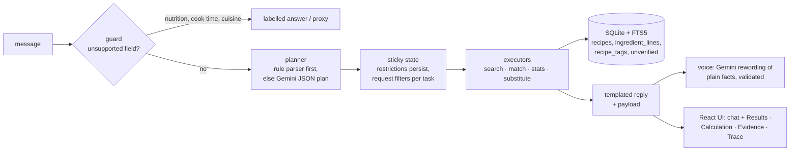

# Recipe Box

A chatbot over 125,164 scraped recipes that answers from the database, not from the model: every count, recipe id and
ingredient claim is computed by code and checkable in the UI. The LLM only turns your message into a plan and
rewords the result.

**Live:** https://recipe-box-chat-production.up.railway.app (`/api/health` shows counts and the build fingerprint) ·
Spec: [PRD.md](PRD.md) · Decisions: [DECISIONS.md](DECISIONS.md)

## Quickstart

Needs Python 3.12 and Node 22. The data (~200 MB zip) is downloaded, never committed. `GEMINI_API_KEY` is optional:
without it the rule parser plans every turn and the answers stay the same (copy `.env.example` to `.env` to set it).
Tested on Windows (a fresh clone, these exact steps); the macOS/Linux steps are the standard equivalents.

Windows (PowerShell):
```powershell
python scripts/setup.py                       # .venv, pip install, npm ci
.\.venv\Scripts\Activate.ps1
python scripts/download.py; python -m backend.app.ingest   # data/raw + data/recipes.db (~7 min, peak RSS ~330 MB)
cd frontend; npm run build; cd ..
python -m uvicorn app.api:app --app-dir backend --port 8000   # http://127.0.0.1:8000
```

macOS / Linux:
```bash
python3 scripts/setup.py
. .venv/bin/activate
python scripts/download.py && python -m backend.app.ingest
(cd frontend && npm run build)
python -m uvicorn app.api:app --app-dir backend --port 8000
```

Docker (what Railway builds; the DB is built inside the image):
`docker build -t recipe-box . && docker run --rm -p 8000:8000 -e GEMINI_API_KEY=$GEMINI_API_KEY recipe-box`

Checks: `python -m pytest -q` (from `backend/`), `python eval/oracle.py`, `python eval/run.py --replay`, and with the
server running `node scripts/screenshots.mjs --mobile` (phone views at 360–768 px; fails on horizontal overflow). All
commands: [RUNBOOK.md](RUNBOOK.md) and the `Makefile`.

## Architecture



Ingest (`backend/app/ingest.py`) parses every ingredient line once: quantity, unit, canonical name, family, allergen
tags (`lexicon/*.yaml`), and the lines it couldn't verify. At runtime nothing is re-parsed and the LLM never sees the
data, only the plan schema. At most 2 LLM calls per turn; any failure falls back to the deterministic rule parser.

## What it does

- **Search (T1).** FTS5 BM25 on title + ingredients, with every restriction as a SQL filter on the full set before
  ranking (never a post-filter on a top-k). Restrictions are about the person and persist; the dish, step limit,
  have-list and must-include filters belong to one request and clear on a new dish or task, with a "Restore previous
  filters" chip. Diet words inside a dish ("vegetarian biryani", "veg", "eggless") become filters. Zero results relax
  only the search words (synonyms, then modifiers, then the head dish), and the reply says what was relaxed.
- **Match (T2).** "I have eggs, onions and rice": ranks recipes by how much of your pantry they use (formula below),
  with quantities checked when you give them, and flagged one-constraint alternatives when nothing qualifies.
- **Stats.** Counts, percentages, top ingredients, mean/median, rankings; each one reported strict and broad, with the
  SQL and the denominator in the Calculation tab.
- **Substitution (T3).** "Remove the eggs from this banana bread": candidates graded by evidence from similar recipes,
  safety-checked against your restrictions, then an adapted recipe (ingredient diff + rewritten steps + a final
  safety gate).
- **Honest refusals.** No nutrition, cook time, servings, ratings, category or cuisine fields exist: the guard says so,
  or runs a clearly labelled title-keyword proxy (cuisine, category).

## Counting and normalization

- N is always out of the **122,933 valid** recipes (title + ≥ 1 real ingredient line + instructions); the 2,231
  invalid records and their reasons are read from the DB at startup.
- Steps = non-empty newline steps; when the instructions are one paragraph of 2+ sentences, sentences are counted.
- Each ingredient line maps to a canonical (`2 cloves garlic, minced` → `garlic`) and a family. **Strict** = the family
  (fresh garlic forms); **broad** = plus processed forms (garlic powder, garlic salt) from `lexicon/families.yaml`.
- An "or" alternative alone doesn't count as containing an item. Ties break by steps, then ingredients, then id.
- `eval/oracle.py` recomputes demos 2 and 3 from the raw JSON in pure Python and must agree with the app.

## Safety model

- Tags: dairy, egg, peanut, tree_nut, gluten, soy, sesame, meat, pork, poultry, fish, shellfish, gelatin, honey, alcohol,
  root_veg. Presets (vegan, vegetarian, Jain, halal, nut allergy, …) are compositions of tags, shown as one chip.
- **Unknown is not safe.** A recipe passes "no dairy" silently only if every line is verified: a known canonical, or
  a phrase the scanner cleared ("dairy-free"). Otherwise it is shown after every verified recipe with ⚠ naming the
  line (about 30% of recipes have such a line for a given tag).
- **may_contain**: label-dependent products (chocolate, margarine, cake mix) warn instead of passing.
- **Strict mode** (a chip) excludes may_contain and unverified recipes too. Substitutes and adapted recipes go through
  the same checks; an adapted recipe that still fails is called "not safe", never "dairy-free".

## Match score

`score = 2·matched − 1·extra − 0.1·steps − 0.5·short-quantity items`, where U = your ingredients, P = pantry staples
assumed (salt, black pepper, water; "no staples" turns them off), R = recipe ingredients − P, matched = U∩R,
extra = R−U. "As many as possible" → 3·matched, "fewest additional" → 1.5·extra, "fewest steps" → 0.5·steps. Ties:
more matched, fewer extra, fewer steps, id. Weights: `WEIGHTS` and `PREF_WEIGHTS` in `backend/app/match.py`.

## Substitution evidence

- Tiers: **L1** = recipes whose title has the most specific dish phrase with ≥ 10 recipes, ≥ 3 of them without the
  item ("tomato cream sauce" → "cream sauce" → "pasta"); **L2** = same dish context, ingredient Jaccard ≥ 0.35;
  **L3** = the whole context. For each candidate: how often recipes *without* the item use it vs recipes *with* it.
- **Strong** = favoured in L1 with ≥ 3 supporting recipes (or an explicit "eggless …" variant + ≥ 2), never a staple;
  **Moderate** = ≥ 3 in L2; **Weak** = any support (adapted, labelled "Weak evidence: based on n recipes").
- **Widening**: if no candidate is Strong or Moderate, L1 widens to the next less specific phrase, and the reply says so.
- **Omit**: for seasonings and optional items (salt, pepper, garnishes, herbs, nuts on top) "omit it" is a candidate,
  graded by how many same-dish recipes go without it ("8 of 18 broiled chicken recipes have no salt"); the line is
  removed and the steps adjusted.
- A defining ingredient (egg whites in a meringue) asks before adapting. Every cited recipe id is re-checked.

## Evaluation

`eval/cases.yaml`: 35 cases, 66 turns, programmatic assertions only (results re-checked with independent SQL, stats
against the oracle). Latest results, latency and the full table: [eval/REPORT.md](eval/REPORT.md).

| | result |
|---|---|
| Live (Gemini, one run) | **35 / 35**; 22 of its LLM calls failed (free-tier 429s / 503s) and fell back |
| Replay (the live run's cached answers, final code) | **35 / 35**; p50 143 ms / p90 592 ms per turn (engine only) |
| LLM off entirely (rule parser only) | **35 / 35** |
| Oracle (demo 2 and 3 numbers, pure Python) | 9 / 9 |
| Unit tests | 244 |

Raw-Gemini baseline (same questions, no tools, `eval/baseline_oneshot.py`):

| question | raw Gemini | Recipe Box |
|---|---|---|
| recipes with garlic and onion | "45,210, about 36.1%" | 16,065 strict (13.07%) / 23,068 broad (18.76%), oracle-equal |
| a dairy-free penne recipe id | `epi:241470` (doesn't exist) | 10 real ids, each verified dairy-free |
| eggs, onions, tomatoes, rice: five recipes | 5 ids, none exist | 5 real ids with the score breakdown |
| valid recipe count | only the record count | 122,933 valid of 125,164 |
| five tomato recipes with fewest steps | declined | the oracle's 5 ids |

## Tag audit (honest summary)

Gemini audited the rules offline, never at runtime ([docs/tag_audit.md](docs/tag_audit.md)): 3,000 most common
canonicals plus a fixed sample of 150 recipes. The first pass found 497 "contains vs nothing" disagreements; the real
misses were fixed (wine names, cheese brands, cuts of meat, …), the LLM errors were kept with reasons. On the sample,
the one real silent miss (claret, alcohol) is fixed, so the measured miss rate is 0, but 150 recipes give few
positives per tag: that is evidence, not proof. Known gaps are in [docs/lexicon_todo.md](docs/lexicon_todo.md).

## Known limitations

- The lexicon is the ceiling: an ingredient it doesn't know is "unverified", so ~30% of recipes carry a ⚠ for any
  given tag. Open items: [docs/lexicon_todo.md](docs/lexicon_todo.md).
- Deliberate shortcuts (`ponytail:` comments): one lock around the shared SQLite connection; FIFO (not LRU) evidence
  cache; search reads every eligible row once instead of COUNT + LIMIT; the FTS safety net's safe phrases are
  per recipe; observed amounts use a 300-recipe sample; the step rewriter guesses an unknown role inside its one call.
- Free-tier Gemini is flaky (503s, timeouts): one live eval run saw 18 LLM errors in 40 turns. Every failure falls
  back to the deterministic rule parser or the templated reply; a grey dot marks those turns.
- No cuisine, category, nutrition or time fields: proxies are labelled, and dishes not named that way are missed.
- Sessions live in memory (30 min TTL), one worker.

## AI tools used

Claude Code implemented this codebase milestone by milestone under my PRD. I wrote the PRD and made and reviewed the
design, the counting and safety rules, the evidence grading and the evaluation decisions; every milestone ended with
my review and fixes. At runtime Gemini (`gemini-3.5-flash-lite`) is the planner (message → JSON plan), the voice
(rewords a plain-English facts block; every number and id must be in it and no internal word may appear, else the
template is shown) and the step rewriter for substitutions (validated, with a
deterministic fallback). Offline, Gemini audited the allergen tags.

More: [DECISIONS.md](DECISIONS.md) · [docs/interview-notes.md](docs/interview-notes.md) ·
[docs/DATA_PROFILE.md](docs/DATA_PROFILE.md) · [docs/FINAL.md](docs/FINAL.md)
