# Final report: M6 part 2 (2026-11-13)

Fixes from your live testing, presentation polish, docs and ship checks. Nothing is pushed; no DB rebuild was needed
(every fix is code or a query-time lexicon change).

## Results

| | |
|---|---|
| Unit tests | **244 passed** (`python -m pytest -q` from `backend/`), up from 232 |
| Eval, live (Gemini, one run) | **35 / 35** cases (66 turns). 22 of its LLM calls failed (free-tier 429 quota, 503s) and fell back |
| Eval, replay (final code, the live run's cached answers) | **35 / 35**; p50 143 / p90 592 ms per turn; at most 2 LLM answers per turn |
| Eval, LLM off entirely | **35 / 35** (rule parser on every turn) |
| Oracle (pure Python, LLM off) | **9 / 9 PASS** (demo 2: 16,065 / 23,068; demo 3: 14,703 analyzed, same 5 ids) |
| Fresh clone of the GitHub repo + README steps | **Works, no gaps found**: setup 59 s, download 1 min 19 s, DB build 4 min 52 s (same counts and fingerprint: 125,164 / 122,933, vocab 20,206, 994 MB, peak RSS 331 MB), UI build, 243 tests, `/api/health` ok, a chat request answered, the UI served |
| Ship checks | `.env` and `data/` untracked and ignored; every commit authored by Faiz Jamal; the trailer grep prints nothing |

## What changed

**A0, the bugs from your live testing.** Each became an eval case first (11 cases, all failing), then a fix:
1. *"Actually I'm not vegan anymore, just no peanuts".* Removal phrasing ("not X anymore", "no longer X", "X is fine
   now", "I can eat X", "drop vegan", "remove the dairy restriction") removes presets and tags. "Just/only no X" makes X
   the only restriction. Leftover words become a dish only if they name a food (a vocab word, or a word in ≥ 10 titles),
   so "actually not anymore" no longer replaces "pasta". With the LLM down and nothing parseable, the bot asks one short
   question with chips ("Back to penne pasta") instead of running a junk keyword search.
2. *"make it vegetarian" after a chicken biryani search.* Diet and allergy words inside a dish query are filters
   ("vegetarian biryani", "veg biryani", "eggless banana bread", "dairy-free pasta"), for both planner paths. With no
   recipe opened, "make it vegetarian" filters the current search and drops the meat word, with a note ("Dropped
   'chicken' from the dish: it contains meat…"). Zero results relax only the search words (synonyms, then modifiers,
   then the head dish), name exactly what was relaxed, and say the restrictions were not.
3. *Task switch.* Restrictions persist. A new dish or task clears the dish, step limit, have-list, must-include and
   prefs, says so, and offers a "Restore previous filters" chip (`restore previous filters` is a rule-level intent).
4. *Omit option.* Salt, pepper, garnishes, herbs, nuts on top: "omit it" is a candidate, graded by how many same-dish
   recipes go without it. Demo: "remove the salt" on Chef John's Broiled Chicken → "8 of 18 'broiled chicken' recipes
   have no salt" (Strong), line removed, step 2 adjusted ("Season chicken with salt." dropped).
5. *Kept-restrictions note* names presets: "Kept your restrictions (vegan, no peanuts)".
6. Found while doing it: the "No step limit?" chip sent "remove the step limit", which the substitution parser took as
   an edit ("Which recipe should I change?"). Filter words are no longer substitutions.
7. Found in the live run: one turn made 3 LLM requests (planner, then a voice call that hit a 503 and retried on the
   fallback model). The 2-per-turn cap is now enforced in one place (`llm.turn()`, `MAX_PER_TURN`), counting retries,
   fallbacks and cache hits, with a regression test.

**P, presentation.** A "Developer view" switch in the header (off by default, saved in localStorage inside
try/catch, `?dev=1` forces it). Off: no SQL, planner badges, timings, trace, raw filter strings or invalid-records
breakdown. Replies are plain English ("2,219 fully verified recipes match 'pasta' with your restrictions (no peanuts) —
of 122,933 recipes"). Chat lists are clickable titles that open the drawer, ids stay small and copyable on cards. Match
cards say "Uses 3 of your 4 ingredients · 2 extra ingredients to buy · 4 steps" (the score bar is dev-only). The
exact answer under a voice reply is folded ("Show exact numbers"). A planner fallback is a grey dot with a tooltip.
The Calculation tab opens with one plain sentence, the query folded under "Show query". Below 900 px the panel stacks
under the chat and the page scrolls; nothing overflows at 390 px. "Chosen because" in the substitution bubble is plain
words now (lift and tier names stay in the evidence table).

**E, eval.** 35 cases (24 + 11), checks moved to `eval/checks.py` with 7 new assertion keys. One live run, then
replay; `eval/REPORT.md` regenerated on the final code with hand-written notes.

**C, docs.** README rewritten (pitch, quickstart for Windows and macOS/Linux, Docker, mermaid architecture, one
section per task, counting and safety rules, the score formula, evidence + widening + omit, eval + baseline, the tag
audit, limitations, AI tools). `DECISIONS.md` (24 decisions). `docs/interview-notes.md` (10 points per milestone M0–M6
and a live-coding table: weights, allergens, presets, step rule, stats ops, thresholds, candidates, omit, LLM, dev view).

**D, ship checks.** Cloned github.com/FaizJamal06/recipe-box-chat into a temp folder, fast-forwarded it with the local commits, and followed the README's Windows steps in order (calling `.venv/Scripts/python` instead of activating, since the check ran in Git Bash). Everything worked as written; no README fix was needed. The macOS/Linux block was not run (Windows machine). `.env` and `data/` are untracked and git-ignored; the author check prints nothing.

## Screenshots

Taken by `node scripts/screenshots.mjs` (headless Chrome, `?q=` replay) against the local server with
`LLM_REPLAY=1` (cached answers, no quota). Phone shots are full-page.

| view | 1440 px, clean | 1440 px, developer view | 390 px, clean | 390 px, developer view |
|---|---|---|---|---|
| Search (penne → no dairy) | 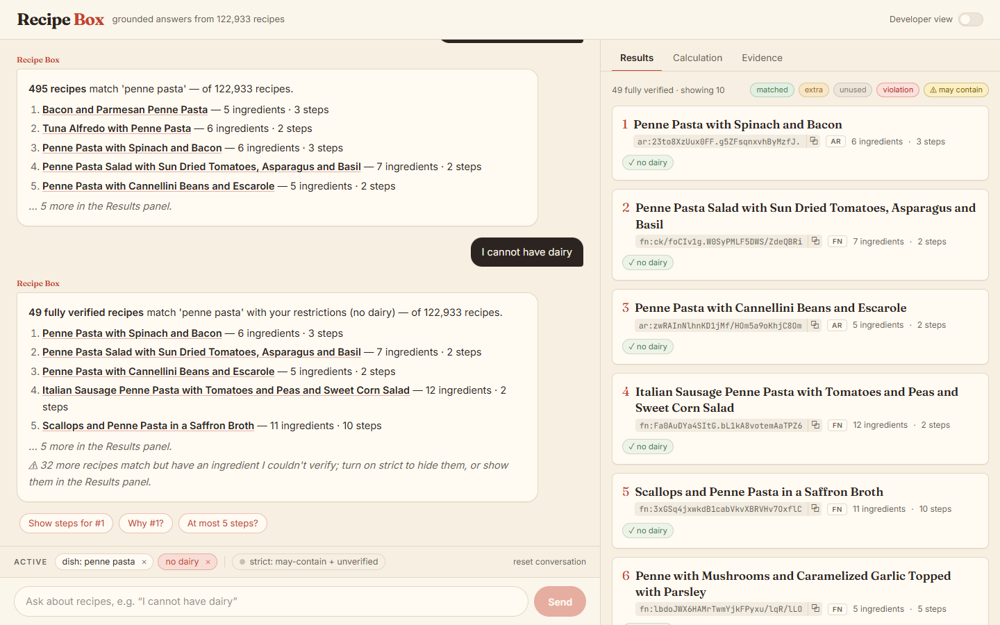 | 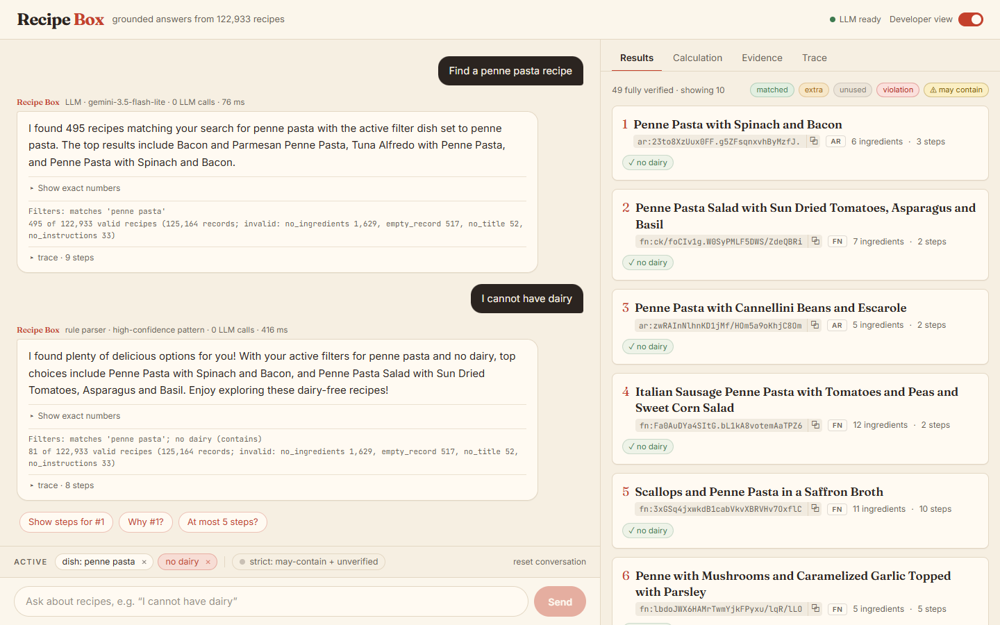 | 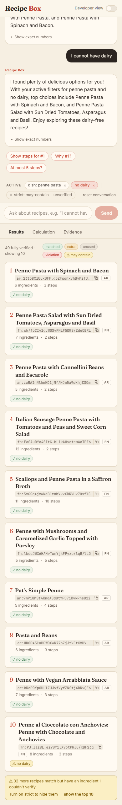 | 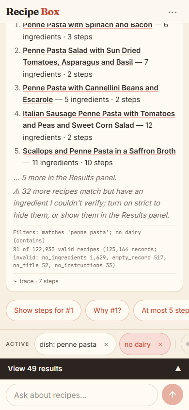 |
| Match (demo 5) | 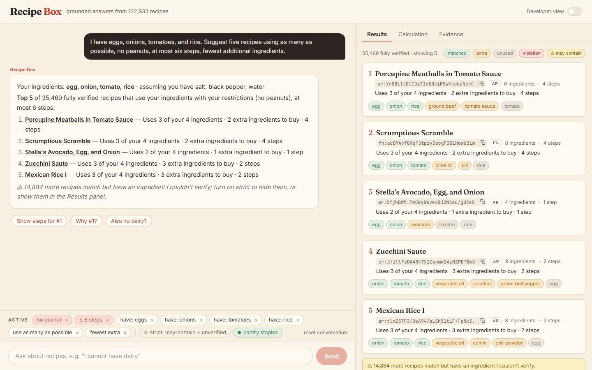 | 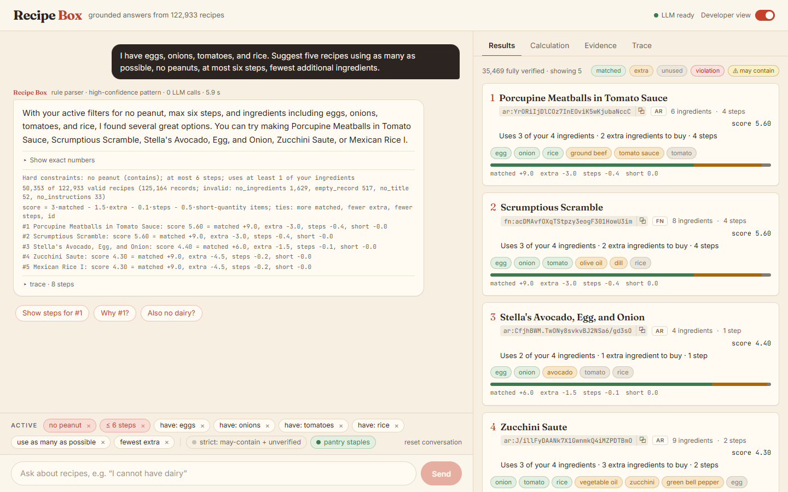 | 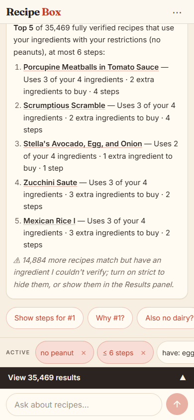 | 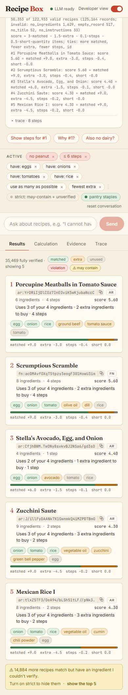 |
| Stats + Calculation (demo 2) | 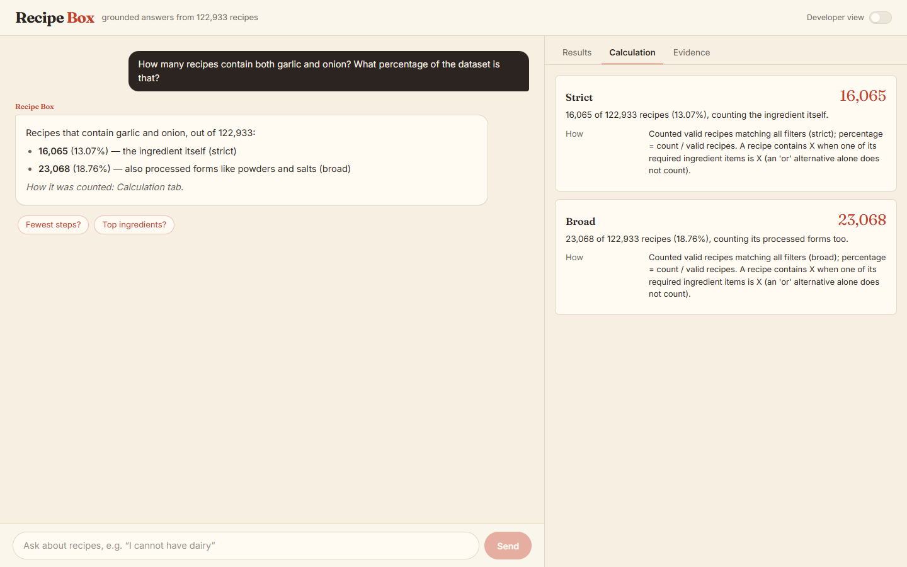 | 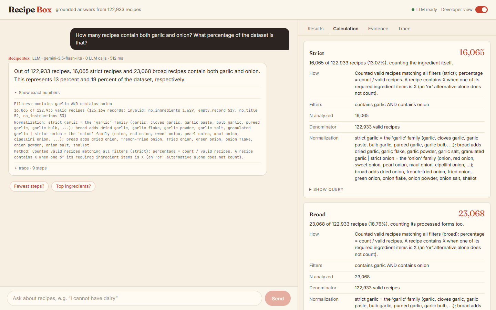 | 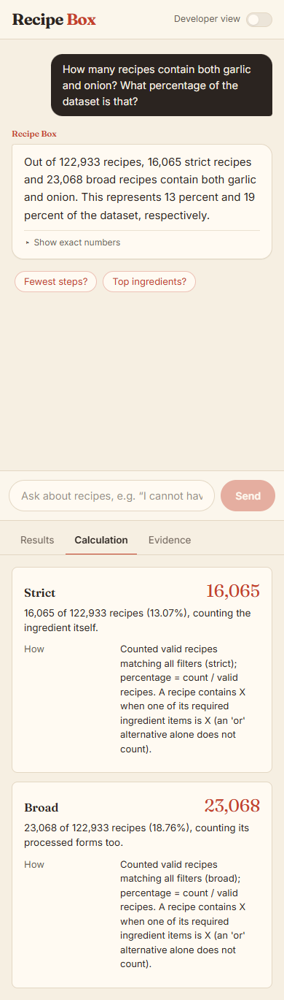 | 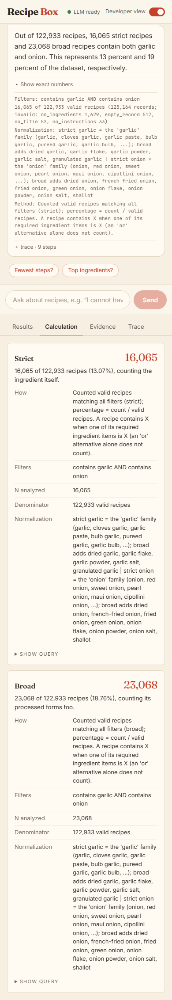 |
| Substitution (demo 7) | 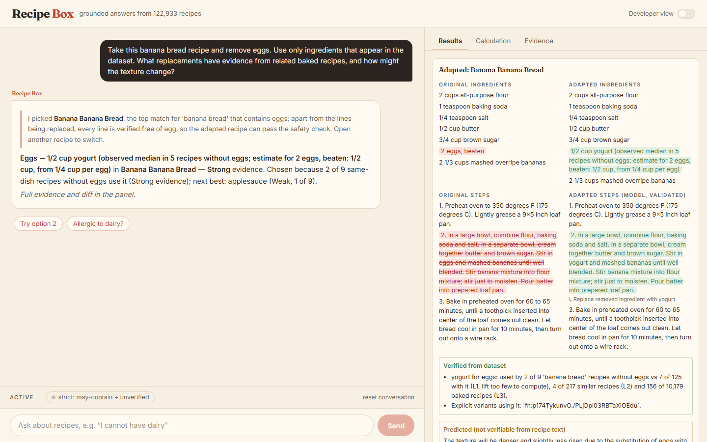 | 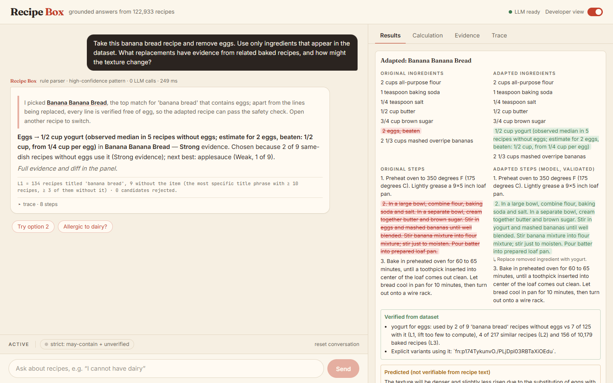 | 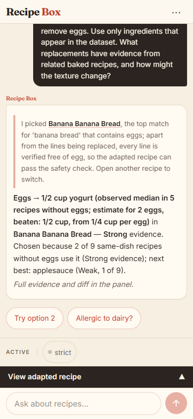 | 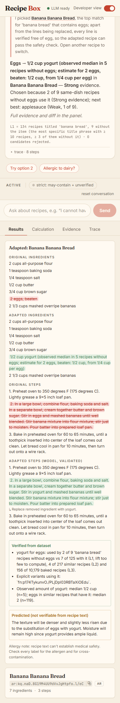 |

## Decisions I made without you

1. **Food word** = in the ingredient vocabulary, or in ≥ 1 title per 10k recipes (10 on the full data: "biryani" 23,
   "actually" 3), and not a filler word. The threshold scales so the 23-recipe test fixture works.
2. **"veg" = vegetarian only at the start of a dish** ("veg biryani"). Mid-dish ("mixed veg curry") it stays a word,
   and relaxation maps it to "vegetable".
3. **"make it vegetarian" with no recipe opened** filters the current search and drops conflicting animal words from the
   dish (said in the reply). With a recipe opened it is still a substitution. A typed "vegan chicken curry" still asks.
4. **What counts as a task switch:** a dish different from the current one, a new have-list, or a fresh "something
   vegan" request. Cleared: dish, must-include, step limit, have-list, prefs, limit, the selected recipe. Restore brings
   back have-list and prefs only when the task type is the same.
5. **"Just no X" replaces person-level restrictions only** (excluded ingredients, tags, presets), not the step limit.
6. **"drop/remove" is restriction removal only for a preset name or with a restriction noun** ("drop vegan", "remove the
   dairy restriction"); "remove the eggs" is still a substitution.
7. **The clarifying question fires only when the LLM failed or is off** and the rule parse has no food word and no
   restriction change. It reuses the existing short question; the first chip goes back to the previous dish.
8. **Omit thresholds:** Strong = ≥ 3 L1 recipes without it and ≥ 25% of L1; Moderate = the same on L2; Weak = any.
   "Omit it" skips the safety check (it adds nothing). The optional list lives in `roles.yaml`, plus line phrases
   ("for garnish", "optional", "to taste").
9. **The LLM budget counts cache hits,** so a replay takes the same paths as the live run.
10. **Developer view also hides the header's "LLM ready" status;** the strict-mode chip stays visible (it is a safety
    control, not an internal).
11. **Calculation tab, clean view:** the summary sentence, "How" (method) and notes. Filters, normalization, N,
    denominator and the SQL are developer view.
12. **Fresh clone:** GitHub has no unpushed commits, so I cloned GitHub and fast-forwarded the clone with the local
    commits (what GitHub will hold after your push), then followed the README in that folder.
13. **Live URL:** https://recipe-box-chat-production.up.railway.app (from you, after this report was first written).
14. **No second live run** after the budget fix: the free tier was already returning 429s, and you asked for one. The
    replay re-checks every case on the final code.
15. **No frontend-design skill** is available in this environment, so I kept the existing visual identity by hand.
16. **`confident()` moved from rules.py to planner.py** to keep rules.py under 300 lines.

## Not done, or worth knowing

- **Railway redeploy and the demo recording:** not done (the redeploy needs your push).
- **The live eval row predates three fixes** (the turn budget, the "chosen because" wording, the voice facts block);
  replay covers them.
- **Voice label leak (fixed in a follow-up):** Gemini echoed state labels ("with the active filter dish set to penne
  pasta") because its prompt carried the chips string and JSON keys. It now gets a plain-English facts block
  (restrictions by name, no keys, codes or ids), and the validator rejects internal tokens ("dish set to", "active
  filter", "may_contain", "unverified", underscores, raw tag names, key=value), falling back to the template; test in
  `tests/test_chat.py`. The new prompt misses the voice cache once, so a replay shows template replies until the next
  live run fills it.
- **`substitute.py` (297) and `normalize.py` (298)** are close to the 300-line limit; the next feature
  in those files should start by moving something out (e.g. `substitute._discovered` into evidence.py).
- **Still open from earlier:** 11 recipes with a junk "for lining"-style canonical (next rebuild), and the lexicon items
  in `docs/lexicon_todo.md`.

## Commands to verify

```bash
cd backend && python -m pytest -q            # 244 passed
cd .. && python eval/run.py --replay         # 35/35, rewrites eval/REPORT.md (no quota)
python eval/oracle.py                        # 9 x PASS (~3 min)
git log --format='%an <%ae>%n%b' | grep -i -E 'claude|anthropic'   # prints nothing
```
